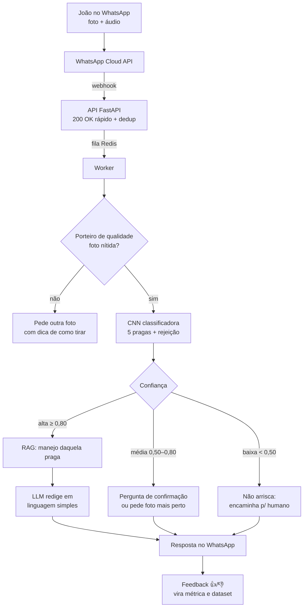

# Documento de Arquitetura — "Doutor da Roça"

**Projeto UPX — Engenharia de Computação / Facens**
Chatbot de WhatsApp para identificação de pragas por foto, com base de conhecimento agronômico (RAG)

**Persona:** João Batista, 54 anos, pequeno produtor de hortaliças e milho na região de Sorocaba.
**Dor:** perde safra porque não identifica a praga a tempo e não tem dinheiro para agrônomo visitar a propriedade.
**Expectativa dele:** tirar foto, mandar num número de WhatsApp, receber resposta rápida e simples dizendo o que é e como resolver sem gastar muito.

**Integrantes:** Matheus Cravo Purcena Gonçalves, Rafael Henrique dos Reis, Samuel de Moraes Delgado, Victor Rodrigues de Oliveira, Vitor Benavides Pitaluga

<!-- Os RAs foram removidos desta cópia porque o repositório pode ser público.
     Mantenha-os apenas na versão entregue ao professor. -->


---

## 1. Requisitos

### 1.1 Funcionais

| ID | Requisito | Origem na persona |
|---|---|---|
| RF01 | Receber foto enviada pelo produtor via WhatsApp | "tirar uma foto do inseto ou da folha doente" |
| RF02 | Aceitar texto ou **áudio** junto da foto ("o que é isso na minha couve?") | João digita pouco; áudio é o hábito dele |
| RF03 | Identificar a praga entre um conjunto **fechado** de 3 a 5 classes | Escopo definido pelo grupo |
| RF04 | **Rejeitar** com honestidade quando não tiver certeza | Confiança do produtor na IA é a pergunta aberta do checklist |
| RF05 | Responder em português simples: o que é, qual o dano, o que fazer | "resposta rápida e simples" |
| RF06 | Ordenar as recomendações **do mais barato para o mais caro** | "sem gastar muito" é prioridade dele, não do grupo |
| RF07 | Encaminhar para atendimento humano / Casa da Agricultura quando a confiança for baixa | Substitui o agrônomo que ele não pode pagar |
| RF08 | Coletar feedback do produtor sobre o acerto (👍/👎) | Vira métrica de banca e dataset |
| RF09 | Guardar histórico de diagnósticos por produtor | Base para relatório e evolução |
| RF10 | Painel interno mínimo com métricas para o grupo | Avaliação do projeto |

### 1.2 Não funcionais

| ID | Requisito | Meta | Por quê |
|---|---|---|---|
| RNF01 | Latência percebida da resposta | ≤ 30 s (p95) | Ele está no meio do serviço, de pé na roça |
| RNF02 | Tolerância a 3G/4G instável | Resposta 100% em texto curto, sem link obrigatório, sem imagem de volta | Sinal oscila na propriedade |
| RNF03 | Custo de operação | ~R$ 0/mês no MVP | Não há orçamento |
| RNF04 | Zero instalação | Nenhum app novo, nenhum cadastro, nenhuma senha | "sem precisar baixar aplicativos novos" |
| RNF05 | Conformidade LGPD | Consentimento no 1º contato, telefone com hash, EXIF removido | Foto + telefone = dado pessoal |
| RNF06 | Segurança agronômica e legal | Nunca prescrever dose de agrotóxico | Receituário agronômico é exigência legal — ver §7 |
| RNF07 | Reprodutibilidade | `docker compose up` sobe tudo | Banca e continuidade do projeto |

### 1.3 Restrições

- 5 alunos, ~12 semanas úteis (20/08 → meados de dezembro), sem orçamento e sem GPU dedicada.
- Fora de escopo (definido pelo grupo): previsão de clima, drones, app mobile nativo completo.
- Fora de escopo (acrescentado por decisão de arquitetura): múltiplas culturas além de hortaliças e milho, multiusuário simultâneo em escala, receituário agronômico automatizado.

---

## 2. Visão geral da arquitetura

```
   ┌──────────────┐
   │  João (WhatsApp) │  foto + áudio/texto
   └────────┬─────────┘
            │ (a rede do celular guarda e reenvia sozinha quando volta o sinal)
            ▼
   ┌────────────────────────┐
   │  WhatsApp Cloud API    │  (Meta) — canal
   └────────┬───────────────┘
            │ webhook HTTPS (POST)
            ▼
   ┌────────────────────────────────────────────────────────┐
   │  API  (FastAPI)                                        │
   │  • valida assinatura HMAC                              │
   │  • responde 200 OK em < 1 s   ← obrigatório            │
   │  • deduplica por wa_message_id                         │
   │  • enfileira job                                       │
   └────────┬───────────────────────────────────────────────┘
            │ Redis (fila)
            ▼
   ┌────────────────────────────────────────────────────────┐
   │  WORKER  (Celery/RQ)  — pipeline de diagnóstico        │
   │                                                        │
   │  1. baixa a mídia (Graph API)                          │
   │  2. porteiro de qualidade (borrão / tamanho / é foto?) │
   │  3. pré-processo (EXIF off, resize, normalize)         │
   │  4. CLASSIFICADOR CNN  → (classe, confiança)           │
   │  5. ROTEADOR DE CONFIANÇA  → direto / dúvida / humano  │
   │  6. RAG: busca manejo daquela praga na base curada     │
   │  7. LLM: só REDIGE a resposta (não decide nada)        │
   │  8. envia resposta pela Cloud API                      │
   │  9. agenda pergunta de feedback                        │
   └───┬─────────────┬──────────────┬───────────────────────┘
       │             │              │
       ▼             ▼              ▼
  ┌─────────┐  ┌──────────┐  ┌──────────────┐
  │ Postgres│  │ Storage  │  │ LLM (API)    │
  │ +pgvector│ │ (fotos)  │  │ + Embeddings │
  └─────────┘  └──────────┘  └──────────────┘
       │
       ▼
  ┌───────────────────────┐
  │ Painel interno        │  acurácia, matriz de confusão,
  │ (Streamlit)           │  taxa de "não sei", latência, uso
  └───────────────────────┘
```



---

## 3. A decisão central: como a IA decide

Esta é a decisão que define o projeto. Três caminhos:

| | **A. VLM direto** | **B. CNN própria** | **C. Híbrido (recomendado)** |
|---|---|---|---|
| Como funciona | Manda a foto para um modelo multimodal (GPT-4o, Gemini) e pede o diagnóstico | Treina uma rede própria nas 5 classes | **CNN decide a praga; RAG traz o manejo; LLM só escreve** |
| Tempo até funcionar | ~1 semana | ~4 semanas | ~5 semanas |
| Dataset | Nenhum | Obrigatório | Obrigatório |
| Dá para medir acurácia? | Difícil — a saída é texto livre | Sim, matriz de confusão | Sim |
| Risco de alucinação | **Alto** — pode inventar praga e inventar produto | Nulo no diagnóstico | Controlado: nenhum componente generativo escolhe a praga nem inventa o produto |
| Custo por foto | Pago sempre | ~R$ 0 (roda em CPU) | Só o texto vai para o LLM (barato) |
| Defesa na banca | Fraca: "chamamos uma API" | Boa | **Forte: engenharia de verdade em cada camada** |

**Recomendação: C.** O argumento é simples e vale repetir na apresentação:

> **Separamos quem decide de quem escreve.** A CNN decide qual é a praga (decisão fechada, mensurável, com matriz de confusão). O RAG busca o manejo em documentos curados da Embrapa e da CATI. O LLM não decide nada — ele só traduz um texto técnico para o português do João. Assim, o sistema não tem como inventar uma praga que não existe nem recomendar um produto que não está no documento.

Isso responde direto à pergunta que o próprio grupo deixou em aberto no checklist — *"o produtor confia na resposta de uma IA?"*. A resposta arquitetural é: ele confia mais num sistema que **sabe dizer que não sabe**.

### 3.1 Classes (fechar na semana 2, com o produtor)

Sugestão para hortaliças + milho na região:

| # | Praga | Cultura | Por que entra |
|---|---|---|---|
| 1 | Lagarta-do-cartucho (*Spodoptera frugiperda*) | Milho | A mais destrutiva do milho; dano visual muito característico (cartucho raspado) |
| 2 | Traça-das-crucíferas (*Plutella xylostella*) | Couve, brócolis, repolho | Praga nº 1 das brássicas |
| 3 | Pulgão (*Myzus persicae* / *Brevicoryne brassicae*) | Hortaliças em geral | Colônia é visualmente distinta e fácil de fotografar |
| 4 | Mosca-branca (*Bemisia tabaci*) | Tomate, hortaliças | Comum e transmite vírus |
| 5 | Vaquinha (*Diabrotica speciosa*) | Milho e hortaliças | Furo redondo na folha, dano inconfundível |
| 6 | **`desconhecido`** | — | **Classe obrigatória** — ver §3.3 |

> Comece com **3 classes**, não 5. Cinco classes com dataset ruim tem acurácia pior que três com dataset bom, e classe a mais é fácil de acrescentar depois. Confirme com o João e com a Casa da Agricultura de Sorocaba quais são realmente as três que mais doem — não assuma.

### 3.2 Dados

- **Base pública:** [IP102](https://github.com/xpwu95/IP102) (CVPR 2019) — ~75 mil imagens, 102 classes de pragas agrícolas, disponível também no Kaggle. Filtre só as classes de interesse. É o ponto de partida honesto.
- **Complemento:** iNaturalist/GBIF (fotos de campo com licença aberta) — importantes porque IP102 tem viés de foto "bonita".
- **Fotos próprias:** na visita ao João e a vizinhos — mesmo 50 fotos por classe, tiradas com celular, no sol, com fundo bagunçado, valem mais do que 500 de laboratório. **Este é o diferencial do trabalho de vocês** e o que a banca vai valorizar.
- **Augmentation:** rotação, brilho/contraste, blur leve, recorte aleatório — simula exatamente a foto ruim que vai chegar.
- Meta realista: 200–400 imagens por classe após augmentation; acurácia top-1 esperada entre **75% e 90%** em imagens limpas, e sensivelmente menor em foto real de campo. **Reporte os dois números.** Um trabalho que mostra a queda e explica por quê vale mais que um que reporta só o número bonito.

### 3.3 O roteador de confiança (o componente mais importante do sistema)

```python
if conf >= 0.80:          # responde o diagnóstico
    rota = "direto"
elif conf >= 0.50:        # arrisca, mas pede confirmação
    rota = "duvida"       # "Parece X. Consegue chegar mais perto e mandar outra?"
else:
    rota = "humano"       # "Não consegui identificar. Leve na Casa da Agricultura."
```

Por que isso importa: **os erros aqui não custam a mesma coisa.** Dizer "é pulgão" quando é lagarta faz o João gastar dinheiro com o produto errado e perder a lavoura mesmo assim. Dizer "não sei" custa apenas uma ida à Casa da Agricultura. Logo, o sistema deve ser **conservador de propósito** — calibre o limiar para errar para o lado do "não sei". Ajuste os limiares pela curva de precisão/revocação no conjunto de validação, não no chute.

---

## 4. Base de conhecimento e RAG

**Corpus curado, não raspado.** Para 5 pragas, são ~25 documentos — vocês leem e selecionam à mão. Fontes: circulares técnicas da Embrapa (milho e hortaliças), boletins da CATI/Casa da Agricultura, AGROFIT (registro de produtos por cultura/praga).

Cada praga vira um registro com campos fixos:

```
praga: lagarta-do-cartucho
cultura: milho
sintomas: folhas raspadas, furos no cartucho, serragem (excremento) no cartucho
nivel_de_controle: 20% das plantas com cartucho raspado
manejo_cultural: plantio na época certa, eliminar restos culturais, evitar plantios escalonados
controle_biologico: Bacillus thuringiensis (Bt); Trichogramma; aplicar no fim da tarde
controle_quimico: existe produto registrado — exige receituário agronômico
custo_relativo: baixo | medio | alto
fonte: Embrapa, Circular Técnica ...
```

**Ponto de arquitetura que economiza semanas:** o RAG **não escolhe a praga** — a CNN já escolheu. O RAG só busca o manejo daquela praga. Então a recuperação é primeiro um **filtro estruturado** por `praga_id` + `cultura`, e a busca vetorial só entra para perguntas livres do produtor ("posso usar sabão?", "é perigoso pro gado?"). Com corpus desse tamanho, o filtro faz 90% do trabalho — usar embedding para tudo seria complicar sem ganho.

- Chunks de 300–500 tokens, com metadados (`praga_id`, `cultura`, `tipo_manejo`).
- Vetores em `pgvector` no mesmo Postgres (uma peça a menos de infraestrutura que manter).
- Embeddings: modelo multilíngue leve rodando local (ex.: `paraphrase-multilingual-MiniLM`) ou API — o corpus é minúsculo, qualquer um serve.

---

## 5. A resposta — projetada para o João, não para a banca

O LLM devolve **JSON estruturado**, não texto solto. O sistema renderiza esse JSON num template fixo. Isso garante formato constante, tamanho controlado e nada de floreio.

Modelo da mensagem:

```
🐛 Parece LAGARTA-DO-CARTUCHO no milho.

O que ela faz: come o miolo da planta nova e seca o cartucho.

O que fazer, começando pelo mais barato:
1. Olhe 10 plantas. Se mais de 2 tiverem o cartucho raspado, vale tratar.
2. Bt (Bacillus thuringiensis) — biológico, barato, aplicar no fim da tarde.
3. Se estiver tomando conta, leve uma folha na Casa da Agricultura.

⚠️ Isso é uma ajuda, não é receita. Para veneno, precisa de receituário.

Acertei? 👍  👎
```

Regras do prompt de redação (todas verificáveis):

- Máximo ~90 palavras. Frases curtas. Sem jargão ("dose", "i.a.", "manejo integrado" → traduzir).
- Usar **exclusivamente** o texto recuperado. Se a informação não estiver lá, dizer que não sabe.
- Sempre listar o mais barato primeiro.
- Sempre encerrar com o aviso e o pedido de feedback.
- Nunca escrever números de dosagem.

> Teste caseiro de qualidade: leia a resposta em voz alta para alguém que não é da área. Se essa pessoa travar em alguma palavra, a resposta falhou.

---

## 6. Canal WhatsApp — a decisão de infraestrutura

| | **WhatsApp Cloud API (Meta)** | **Twilio Sandbox** |
|---|---|---|
| Custo no MVP | **R$ 0** — conversas de *serviço* (iniciadas pelo usuário, respondidas dentro de 24 h) são gratuitas e ilimitadas desde nov/2024 | Crédito de trial; sandbox gratuito |
| Setup | Meta Business + verificação; número de teste gratuito com poucos destinatários | Minutos — o usuário manda um código e entra no sandbox |
| Realismo | É o produto real | Número compartilhado da Twilio; o usuário precisa "entrar" no sandbox |
| Risco | Verificação do Business Manager pode demorar | Menos realista para demonstrar ao produtor |

**Recomendação:** começar pelos **dois em paralelo na semana 1** — o Twilio destrava o desenvolvimento no mesmo dia e o Cloud API roda em segundo plano enquanto a verificação da Meta não sai. Abstraia o canal atrás de uma interface (`ChannelAdapter` com `receber()` e `enviar()`), e trocar um pelo outro vira mudança de configuração. **Nunca** use biblioteca não oficial (Baileys, venom-bot): funciona na demo e derruba o número por violação de termos.

> **Achado que vale destacar na apresentação:** como o João sempre inicia a conversa e o bot responde dentro da janela de 24 h, o MVP inteiro se encaixa na faixa gratuita de mensagens de serviço. O custo de operação do canal é zero — e isso não é sorte, é consequência de ter escolhido o canal certo para a persona.

**Detalhe técnico que costuma quebrar o projeto:** a Meta exige `200 OK` em poucos segundos e **reenvia o webhook** se não receber. Como a inferência + LLM leva de 3 a 15 s, processar dentro do webhook gera timeout, retentativa e resposta duplicada para o produtor. Daí a fila. Deduplique por `wa_message_id`, que é único.

---

## 7. Segurança, ética e LGPD

Três coisas que, se vocês tratarem bem, colocam o trabalho acima da média:

**1. Receituário agronômico.** No Brasil, recomendar defensivo agrícola exige receita de profissional habilitado. Um bot que sai dando dose está errado — técnica e legalmente. A arquitetura resolve isso de forma elegante: o sistema recomenda **manejo cultural e biológico** livremente, e para controle químico diz *"existe produto registrado para isso; procure a Casa da Agricultura para a receita"*. Vocês não perdem utilidade — o manejo barato é justamente o que o João quer — e ganham correção. Escrevam isso no relatório como decisão consciente, não como limitação.

**2. Erro assimétrico.** Já tratado no §3.3, mas repita no relatório: falso positivo confiante é o pior resultado possível deste sistema. A métrica principal não é acurácia — é **precisão nas respostas que o bot escolheu dar**.

**3. LGPD.** Telefone é dado pessoal e foto pode carregar geolocalização no EXIF.

- Primeira mensagem de todas: consentimento em uma linha (*"Posso guardar suas fotos para melhorar o atendimento? Responda SIM."*).
- Guardar o telefone com hash; nome só se ele quiser.
- Remover EXIF na ingestão.
- Definir retenção (ex.: fotos por 12 meses) e um jeito de apagar (*"APAGAR MEUS DADOS"*).
- Termo de consentimento assinado na visita, para uso das fotos no trabalho acadêmico.

---

## 8. Modelo de dados

```sql
produtor(id, wa_id_hash UNIQUE, apelido, municipio, cultura_principal,
         consentimento_em, criado_em)

mensagem(id, produtor_id, wa_message_id UNIQUE,   -- ← idempotência
         direcao, tipo, texto, midia_path, recebida_em)

diagnostico(id, mensagem_id, praga_id, confianca, rota,   -- direto|duvida|humano
            resposta_texto, modelo_versao, latencia_ms, criado_em)

feedback(id, diagnostico_id, util BOOL, comentario, recebido_em)

praga(id, nome_popular, nome_cientifico, culturas TEXT[], sintomas)

documento_kb(id, praga_id, cultura, tipo_manejo, fonte, url,
             trecho TEXT, embedding VECTOR(384))
```

`modelo_versao` em `diagnostico` é o que permite comparar o desempenho antes e depois de retreinar — e vira gráfico no relatório.

---

## 9. Stack sugerida

| Camada | Escolha | Por quê |
|---|---|---|
| API | **FastAPI** (Python) | Mesma linguagem do modelo; async nativo; docs automáticas |
| Fila | **Redis + RQ** | RQ é bem mais simples que Celery e suficiente aqui |
| Banco | **Postgres + pgvector** (Supabase free) | Relacional e vetorial na mesma peça |
| Modelo | **PyTorch → MobileNetV3-Large** (transfer learning), exportado para **ONNX** | Roda em CPU em ~200 ms; treino no Colab grátis |
| RAG/LLM | LangChain (o grupo já citou) ou chamada direta à API | LangChain ajuda no começo e atrapalha no fim — se travar, chame a API direto |
| Storage | Supabase Storage ou volume local | Free tier |
| Painel | **Streamlit** | Painel inteiro em ~100 linhas |
| Deploy | Render / Railway free + **ngrok** no desenvolvimento | Webhook precisa de HTTPS público |
| Contêineres | `docker compose` | Reprodutibilidade para a banca |

> Sobre LangChain: ótimo para montar o RAG rápido, mas ele esconde o prompt, e o prompt é justamente o que vocês precisam controlar (§5). Se o time começar a brigar com abstração, troquem por `psycopg` + chamada direta ao LLM. Não é regressão, é simplificação.

---

## 10. Como medir (isto é o que a banca vai perguntar)

| Métrica | Meta | Como medir |
|---|---|---|
| Acurácia top-1, imagens limpas | ≥ 85% | Conjunto de teste separado do IP102 |
| Acurácia top-1, **fotos reais de campo** | ≥ 65% | Fotos tiradas por vocês e pelo João — **o número que importa** |
| Precisão nas respostas dadas (rota "direto") | ≥ 90% | Dos casos em que o bot arriscou, quantos acertou |
| Taxa de "não sei" | 10–25% | Alta demais = inútil; baixa demais = arrogante |
| Latência p95 fim a fim | ≤ 30 s | Log de `latencia_ms` |
| Feedback positivo do produtor | ≥ 70% 👍 | Tabela `feedback` |
| **Uso real** | João envia ≥ 3 fotos por semana na 3ª semana, sem lembrete | O teste mais duro e mais honesto de todos |

---

## 11. Riscos e planos B

| Risco | Prob. | Impacto | Mitigação |
|---|---|---|---|
| Verificação da Meta não sai a tempo | Média | Alto | Twilio em paralelo desde a semana 1; adaptador de canal |
| Dataset insuficiente para 5 classes | **Alta** | Alto | Começar com 3 classes; augmentation; fotos próprias na visita |
| Acurácia baixa em foto de campo | Alta | Médio | Porteiro de qualidade + pedir foto melhor + rota "não sei"; reportar honestamente |
| Foto ruim (borrada, longe, escura) | Alta | Médio | Variância do Laplaciano para detectar borrão; mensagem com dica de como fotografar |
| LLM inventar recomendação | Média | **Alto** | LLM não decide; prompt restrito ao trecho recuperado; validação de saída |
| João não usar a ferramenta | Média | Alto | Salvar o contato no celular dele na visita, com nome e foto; primeira mensagem enviada junto com ele; combinar retorno |
| Grupo travar em infraestrutura | Média | Alto | Congelar stack na semana 2; `docker compose` desde o começo |
| Custo estourar | Baixa | Médio | Faixa gratuita de serviço do WhatsApp; CNN em CPU; LLM só no texto |

---

## 12. Cronograma (12 semanas úteis)

| Semana | Entrega | Porta de saída |
|---|---|---|
| 1 | Repositório, `docker compose`, webhook que ecoa "recebi sua foto" | Mensagem de ida e volta funcionando |
| 2 | **Visita 1 ao João** (diagnóstico + fotos + consentimento). Canal decidido. 3 classes fechadas | Termo assinado e ≥ 60 fotos reais |
| 3 | Dataset montado, split treino/val/teste, augmentation | Baseline treinado, mesmo que ruim |
| 4 | CNN com transfer learning; matriz de confusão | Acurácia ≥ 80% no teste limpo |
| 5 | Base de conhecimento das 3 pragas (curada à mão) | 3 fichas completas e revisadas |
| 6 | RAG + geração da resposta; template fechado | Resposta gerada a partir de um label fixo |
| 7 | Integração fim a fim: foto → resposta no WhatsApp | Primeiro diagnóstico real ponta a ponta |
| 8 | Roteador de confiança, porteiro de qualidade, feedback 👍/👎, painel | Bot sabe dizer "não sei" |
| 9 | **Visita 2 — teste com o João em campo** | ≥ 15 fotos reais processadas |
| 10 | Correções do que quebrou em campo; retreino com as fotos novas | Nova matriz de confusão comparada |
| 11 | Métricas finais, relatório, vídeo de demonstração | Números fechados |
| **12** | **Congelamento de escopo.** Ensaio da apresentação. **Visita 3 — entrega ao produtor** | Só correção de bug depois disto |

**Data de congelamento: ~15 de novembro.** Depois disso, só bug e documentação. Todo projeto de faculdade que ignora essa data chega em dezembro com código novo e sem relatório.

---

## 13. Divisão para 5 pessoas

| Frente | Responsabilidade | Não deixe acontecer |
|---|---|---|
| **Canal e infraestrutura** | Webhook, fila, deploy, Docker, adaptador Twilio/Meta | Uma pessoa só saber subir o ambiente |
| **Dados e modelo** | Dataset, augmentation, treino, ONNX, matriz de confusão | Treinar sem conjunto de teste separado |
| **Conhecimento agronômico e RAG** | Curar os documentos, montar as fichas, embeddings, retrieval | Copiar texto de blog sem fonte técnica |
| **Conversa e experiência** | Prompt, template de resposta, roteador de confiança, feedback | Escrever a resposta pensando na banca em vez do João |
| **Integração, testes e comunidade** | Testes ponta a ponta, métricas, painel, relatório, **contato com o João** | Mais de uma pessoa ligando para o produtor |

Uma pessoa só como ponto de contato com o João — ele não deve receber mensagem de cinco alunos diferentes.

**Ritual mínimo:** reunião semanal de 30 min com dia e hora fixos, branch protegida, PR com revisão de um colega. Se em duas semanas alguém não tiver commit, o problema é de escopo, não de esforço — redistribuam.

---

## 14. O que eu revisitaria se o projeto continuasse

- **Detecção em vez de classificação.** Trocar a CNN classificadora por um detector (YOLO) resolve a foto com vários insetos e localiza o bicho na folha — mas exige anotação com caixas, inviável neste semestre.
- **Classificação de doença junto com praga.** Míldio e mancha bacteriana são tão frequentes quanto inseto em folhosa, e o João não distingue "bicho" de "doença" — para ele, é tudo "praga".
- **Modelo no dispositivo.** TFLite rodando no celular daria resposta sem internet nenhuma — resolveria de vez o RNF02, mas exige o app que está fora de escopo.
- **Malha de produtores.** Se dez vizinhos usarem, o sistema vê a praga se espalhando pelo bairro e pode avisar antes de chegar: *"apareceu lagarta em três sítios perto do seu esta semana"*. É a evolução mais valiosa e a mais barata de construir — só precisa de usuários.
- **Fechar o ciclo de aprendizado.** Os 👎 viram fila de revisão; um agrônomo parceiro corrige; as fotos corrigidas entram no próximo treino.

---

## 15. Perguntas para levar na Visita 1

1. Quais são, na sua experiência, as **três** pragas que mais dão prejuízo aqui? (não assuma a nossa lista)
2. Quando aparece o problema, o que você faz hoje? Pergunta pra quem?
3. Mostra pra gente uma folha atacada — como você fotografaria isso?
4. Onde na propriedade o sinal cai?
5. Se o bot disser "não tenho certeza", isso te ajuda ou te irrita?
6. Você preferiria receber a resposta escrita ou em áudio?
7. Podemos usar suas fotos no trabalho da faculdade? (termo assinado)
8. Quanto tempo depois da foto a resposta ainda é útil — minutos, horas, no mesmo dia?

A pergunta 5 é a mais importante do projeto inteiro. Toda a arquitetura do §3.3 depende da resposta dela.
